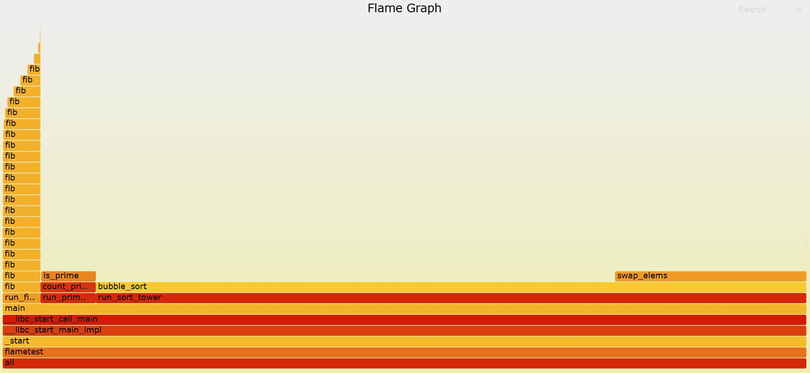

> `kernel/events/core.c`, `arch/arm64/kernel/perf_event.c`, `tools/perf/` · Linux v6.12.34
> Board: Raspberry Pi 5 (BCM2712, Cortex-A76, arm64)
> Verified against: `dmesg` PMU probe line, live `perf stat`/`perf record` runs on this board

## 1. Overview

Phase 4 covered exhaustive, hook-based instrumentation (`ftrace`, `kprobe`) — every call to
an instrumented point is captured, but only at points explicitly chosen ahead of time. Phase 5
covers the complementary approach: **statistical sampling** via hardware performance counters,
which answers *where CPU time actually goes* across code that was never explicitly
instrumented, at the cost of being probabilistic rather than exhaustive.

The `perf_events` kernel subsystem and its userspace client `perf` are the vehicle for this.
eBPF, originally scoped under this phase, has been split into its own phase — see the
Q&A section below.

## 2. PMU / PMUv3 Mechanism

A **Performance Monitoring Unit** is hardware built into the CPU core that counts
architectural/microarchitectural events (cycles, instructions retired, cache misses, branch
mispredicts) with no software overhead on the code being measured. Two properties make it
useful for profiling specifically:

- **Counters are programmable** — each general-purpose counter is assigned to track a
  chosen event ID via a companion type register.
- **Counters can interrupt on overflow** — arm a counter to overflow after N events, and the
  CPU raises an interrupt; the handler captures the PC (and optionally unwinds the stack) at
  that instant. Repeated over many overflows, this builds a statistical profile.

**PMUv3** is the ARMv8-A architecture version implementing this, present on all current
ARMv8-A cores including Cortex-A76. It defines up to 32 counter register slots per core:

| Register | Role | Count |
|---|---|---|
| `PMEVCNTR<n>` / `PMEVTYPER<n>` | General-purpose, independently assignable to any event ID | Up to 31 (architectural max) |
| `PMCCNTR` / `PMCCFILTR_EL0` | Dedicated cycle counter, architecturally separate | 1 |

The architectural maximum of 31 general-purpose counters is **not** what silicon actually
implements — that's an implementation-defined choice per SoC vendor.

Each Cortex-A76 core has its own **private PMU instance**; overflow is signalled as a
per-core PPI (private peripheral interrupt) routed into the GIC. This requires a devicetree
node (`arm,cortex-a76-pmu` or generic `arm,armv8-pmuv3`) with correct per-core interrupt
wiring — without it, the driver never probes and `perf_events` silently falls back to
software-only events.

**Verified on this board**, from the probe-time driver log:

```
[    9.537024] hw perfevents: enabled with armv8_cortex_a76 PMU driver, 7 (0,8000003f) counters available
```

Decoding the mask `0x8000003f` (binary `1000...0011 1111`):
- Bits 0–5 set (`0x3f`) → **6 general-purpose counters** (`PMEVCNTR0`–`PMEVCNTR5`)
- Bit 31 set (`0x80000000`) → the **dedicated cycle counter** (`PMCCNTR`)
- Total = 7, matching the driver's reported count

So BCM2712's Cortex-A76 implements 6 general-purpose counters + 1 cycle counter — well
short of the architectural maximum, and now a confirmed fact rather than an assumption.

### `armv8pmu_handle_irq()` — the sample-capture path

1. Counter is preloaded to overflow after a chosen period (or dynamically recalculated period
   in frequency mode — see Section 3).
2. On overflow, the PMU raises its per-core PPI.
3. `armv8pmu_handle_irq()` reads the overflow status register to identify which counter(s)
   fired, then calls `perf_event_overflow()` per event.
4. `perf_event_overflow()` captures PC and, if requested, unwinds the stack, pushing the
   result into the ring buffer userspace reads.

### IRQ-masking skew — an arm64-specific caveat

If a counter overflows while IRQs are masked in the kernel (e.g. inside a spinlock-held
region), the PMU interrupt cannot be taken until IRQs are re-enabled. The sample gets
attributed to wherever execution happened to be when IRQs were unmasked, **not** to where the
overflow actually occurred. This can produce misleading flame-graph attribution — e.g.
`_raw_spin_unlock_irq`-adjacent code appearing hotter than it really is. Worth treating any
suspiciously hot IRQ-unmask-adjacent frame with skepticism.

## 3. `perf_event_open()` and the `perf` Framework

`perf_events` and `perf` are distinct: `perf_events` is the kernel subsystem
(`kernel/events/core.c`); `perf` is one userspace client, built in-tree (`tools/perf/`) and
versioned alongside the kernel it ships with.

A single syscall, `perf_event_open()`, is the entire interface. It takes a
`perf_event_attr` struct and returns an fd representing a `perf_event` object; `mmap()` on
that fd gives a shared ring buffer the kernel writes samples/counts into. The abstraction
covers four pluggable event sources through the same API:

| Type | Source | Example |
|---|---|---|
| Hardware | PMU counters | `cycles`, `instructions` |
| Hardware cache | Structured subset of PMU events | `L1-dcache-load-misses` |
| Software | Kernel-internal counters, no PMU | `page-faults`, `context-switches` |
| Tracepoint | Static kernel tracepoints (same infra ftrace's event tracer uses) | `sched:sched_switch` |

This is why `perf record -e sched:sched_switch` and `perf record -e cycles` share one
command shape despite riding completely different underlying mechanisms.

### Sampling period vs frequency

Two mutually exclusive modes control how often a sampling event fires:

- **Period** (`attr.sample_period`, `attr.freq = 0`) — fixed event count between samples
  (e.g. every 1,000,000 cycles), regardless of wall-clock rate.
- **Frequency** (`attr.sample_freq`, `attr.freq = 1`) — target samples-per-second; the kernel
  continuously recalculates and reprograms the underlying period (`perf_adjust_period()`) to
  hold that rate as the actual event rate varies.

Frequency mode is `perf record`'s default (~4000 Hz) and is what you want for flame graphs,
since it keeps sample density even in wall-clock time regardless of how bursty the workload
is. Fixed period is preferred when sampling needs to be tied to a specific event count rather
than time — e.g. sampling every N cache misses to find which instructions cause them.

## 4. Enabling `perf_events`

Four independent layers, all of which must be correct:

1. **Kernel config** — `CONFIG_PERF_EVENTS` (the subsystem itself), `CONFIG_HW_PERF_EVENTS`
   (hardware counter backing, depends on `CONFIG_ARM_PMU`), `CONFIG_ARM_PMU` (the actual
   arm64 PMU driver). Without `HW_PERF_EVENTS`, `perf_events` still functions but with
   software events only — no PMU, no flame graphs.
2. **Devicetree/driver probe** — the PMU node must exist with correct per-core interrupt
   wiring. Confirm success via `dmesg | grep -i pmu` (the line decoded in Section 2).
3. **Runtime permission policy** — `/proc/sys/kernel/perf_event_paranoid`. `2` (common
   distro default) blocks kernel-space profiling for unprivileged users; `-1` removes all
   restriction. Adjust via `sysctl kernel.perf_event_paranoid=<n>` or run as root.
4. **Userspace tool version match** — `perf`'s binary is versioned with its source kernel
   tree; a mismatched packaged `perf` can misdecode newer `perf_event_attr` fields.

## 5. `perf list` — Enumerating Available Events

```bash
perf list          # everything
perf list hw        # hardware + cache events
perf list tracepoint
perf list 'sched:*' # glob filter
```

Sections shown: generalized hardware events, hardware-cache events, raw PMU-specific events
(direct evidence of what the PMU driver actually registered — a thin/missing section here
signals a DT probe failure), software events, all static tracepoints, and any `probe:*`
events already created via `perf probe --add`.

**Issue encountered on this board:** hardware events appeared but tracepoint events were
entirely absent, with no error. Cause: `perf list` reads tracepoint formats from tracefs
(`/sys/kernel/tracing/events/*/*/format`), which is root-only by default — the read fails
silently and the section is simply omitted rather than erroring. Fixed with `sudo perf list`.

## 6. `perf stat` — Counting, Not Sampling

The simplest `perf_events` client: open events, let counters run for a command's duration, read
the final value once. No interrupts, no per-sample capture.

```bash
perf stat ls -la /
perf stat -e cycles,instructions,cache-misses ./workload
perf stat -r 10 ./workload      # repeat 10x, report mean ± stddev
```

### Counter multiplexing

If more simultaneous hardware events are requested than there are physical counter slots,
the kernel time-slices the requested events across available hardware, round-robin, then
scales up the reported count based on the fraction of runtime each event actually ran on
real hardware. `perf stat` surfaces this directly:

```
1,234,567,890      cycles     #   62.50% scheduled
```

Below 100%, the number is a statistical extrapolation, not a direct read. On this board,
given the confirmed 6 general-purpose + 1 cycle counter layout, requesting 7 or fewer
simultaneous hardware events (at most one being `cycles`) should stay at 100% scheduled;
8 or more general-purpose events should trigger multiplexing.

## 7. `perf probe` — DWARF Dependency

`perf probe` operates in two modes:

- **Symbol-only (no debuginfo needed)** — probes a function's entry/return via `kallsyms`,
  giving raw register/`$retval` access:
  ```bash
  perf probe --add do_sys_open
  perf probe --add 'do_sys_open%return'
  ```
- **DWARF-required** — local variables (`var→field` syntax), line-number probes
  (`--line`, `file.c:123`), `--vars` listing, and automatic type inference all require a
  `vmlinux` with debuginfo (`-k/--vmlinux`), since only DWARF's variable-location and
  line-number tables make this information available. Missing debuginfo fails explicitly:
  *"no dwarf info found in the vmlinux — please rebuild with `CONFIG_DEBUG_INFO=y`."*

**The same rule applies identically to userspace probing** (`perf probe -x <binary>`) — same
underlying debuginfo-analysis code path, just pointed at a different ELF. Differences:
debuginfo is read from the target binary itself (or its external debug package) rather than
`vmlinux`; `kptr_restrict` concerns don't apply since userspace probing never touches
`kallsyms`; and optimization-stripped debuginfo is more commonly encountered here since
distro-packaged userspace binaries are more often built `-O2` with no `-g` than kernel
builds are.

## 8. `perf record` / `perf report` — Sampled Profiling

```bash
perf record -g --call-graph dwarf -p <pid> -- sleep 5
perf report --stdio
```

`-g` enables call-graph capture — without it, samples carry only the interrupted PC with no
caller context, effectively useless for a flame graph.

### Unwind methods

| Method | Mechanism | Notes |
|---|---|---|
| `fp` (frame pointer) | Walks preserved frame-pointer chain | Fast; silently gives 1–2 frame stacks if the binary/kernel was built without `-fno-omit-frame-pointer` |
| `dwarf` | Captures raw stack at sample time, unwinds later via DWARF CFI | Heavier per sample; needs debuginfo; works when frame pointers are unavailable |
| `lbr` | CPU Last Branch Record hardware | x86 Intel only — **not applicable on Cortex-A76/arm64** |

Given arm64 distro kernels commonly omit frame-pointer preservation, `dwarf` was the
practical default expected on this board, and was confirmed working (Section 9).

Sample rate can be set explicitly with `-F <hz>` — 99 Hz is a conventional choice for
longer/system-wide captures (intentionally non-round to avoid aliasing with periodic kernel
activity), versus the ~4000 Hz default suited to short targeted captures.

## 9. Hands-On Validation — Synthetic Workload

A purpose-built C workload ([`flametest.c`](/assets/linux-debug/flametest.c)) was used to validate the full pipeline, with three
independent, differently-weighted call towers pclus one recursive path:

```c
long fib(int n) {                          // recursive tower — deep, low total time
    if (n < 2) return n;
    return fib(n - 1) + fib(n - 2);
}

int is_prime(long n) { /* ... */ }         // nested-call tower — smallest total time
long count_primes_up_to(long limit) { /* ... */ }

void bubble_sort(int *arr, int n) { /* ... */ }  // O(n^2) tower — dominates total time
void swap_elems(int *a, int *b) { /* ... */ }

int main(void) {
    run_fib_tower();
    run_prime_tower();
    run_sort_tower();
}
```

Compiled with:
```bash
gcc -g -O0 -fno-omit-frame-pointer -o flametest flametest.c
```
`-O0` was deliberate — at `-O2`, small helper functions like `is_prime`/`swap_elems` would
likely be inlined, collapsing the intended tower structure. `-fno-omit-frame-pointer` was
included to allow comparing `fp` against `dwarf` unwinding on the same binary (comparison
not yet performed).

Profiled with:
```bash
perf record -g --call-graph dwarf -- ./flametest
```

**Result:** clean, correctly-structured flame graph — full call chain resolved from `_start`
through `__libc_start_main_impl`/`__libc_start_call_main` into `main` and all three towers,
confirming DWARF unwinding works correctly on this board/toolchain combination without
requiring libc debuginfo (CFI-based unwinding through libc succeeded independent of `-g` on
libc itself).

## 10. Reading a Flame Graph

Two axes carry independent meaning:

- **Width** = proportion of total samples (time). Not related to call order — boxes at a
  given level are typically sorted alphabetically or by size, not chronologically.
- **Height** = stack depth at the moment of a sample. A box's parent (below) is its caller;
  children (above) are what it called.

The flame graph generated from the `flametest.c` capture in Section 9:



Applied to the captured graph: `bubble_sort` was the widest, shallow tower — O(n²) behavior
on a 20,000-element reverse-sorted array dominates total wall-clock time despite a trivial
2-level call structure. `fib` was narrow but tall — recursion to depth 28 produces many
stacked identical frames, but the function consumes comparatively little total time. `is_prime`
was smallest on both axes, consistent with the lightest workload of the three.

### Same function, multiple call sites

If a function is reached via more than one distinct call path, each path gets its own
separate box in the tree — flame graphs only merge stacks that are identical from the root
down to that point. A function's true total CPU cost, if called from multiple places, is the
sum of all its boxes, not any single one. (Not exercised in the synthetic workload above,
since every function here has exactly one call path — but a real kernel/driver trace will
commonly show this.)

### Self time vs total time

A box's width already includes its children's widths (inclusive/total time). Self time —
time spent in the function's own code, excluding callees — is that box's width minus the
combined width of its children. For precise, path-independent aggregated numbers rather than
visual estimation, `perf report --sort=self` computes both self and total time summed across
every call site automatically.

## Q & A

**Q: What is `perf_stat`'s counter multiplexing, and how does it show up in output?**
When more simultaneous hardware events are requested than there are physical PMU counter
slots, the kernel time-slices events across the available hardware and scales up the
reported count based on the fraction of runtime each event actually ran. `perf stat` shows
this as a "scheduled %" annotation below 100% next to the affected event; below 100%, the
number is an extrapolation rather than a direct hardware read.

**Q: How many PMU counters does BCM2712's Cortex-A76 actually implement?**
Confirmed from `dmesg`: `hw perfevents: enabled with armv8_cortex_a76 PMU driver, 7
(0,8000003f) counters available`. Decoding the mask: bits 0–5 set = 6 general-purpose
counters, bit 31 set = 1 dedicated cycle counter, total 7 — short of the architectural
maximum of 31 general-purpose slots, confirming the count is implementation-defined per SoC
rather than assumable from the architecture alone.

**Q: Does `perf probe` need DWARF debuginfo to work, and is userspace probing the same?**
Symbol-only probing (function entry/return via `kallsyms`) works without any debuginfo.
Local variables, line-number probes, `--vars`, and automatic type casting all require DWARF
(a `vmlinux` with debuginfo, via `-k`). Userspace probing (`perf probe -x <binary>`) follows
the identical rule — same code path, different ELF as the debuginfo source — except
`kptr_restrict` concerns don't apply, and stripped/optimized debuginfo is more commonly
encountered on the userspace side.

**Q: Does the kernel needing `CONFIG_DEBUG_INFO=y` block flame-graph generation for a
userspace workload built with `-g`?**
No. Userspace call-graph unwinding reads CFI/DWARF from the target binary and its linked
libraries directly, independent of `vmlinux`'s debug info. Kernel `CONFIG_DEBUG_INFO` only
affects kernel-side `perf probe`/`perf annotate` functionality. If a sampled stack crosses
into kernel space, kernel-side symbol name resolution comes from `/proc/kallsyms` (gated by
`kptr_restrict`, not `CONFIG_DEBUG_INFO`), and arm64 kernel-side stack unwinding uses the
kernel's built-in frame-pointer unwinder (`unwind_frame()`), not DWARF CFI — another path
independent of `CONFIG_DEBUG_INFO`. Confirmed in practice: a `flametest.c` workload compiled
with `-g -O0 -fno-omit-frame-pointer` produced a fully resolved flame graph, including
correct unwinding through libc, on a kernel without `CONFIG_DEBUG_INFO` set.

**Q: How does `perf script` feed the flame graph pipeline, and does this `perf` build have
flamegraph support built in?**
`perf script` dumps one line/block per raw sample, in capture order, fully expanded — the
opposite of `perf report`'s aggregated tree view, and the format the external flame-graph
toolchain expects:
```bash
perf script > out.perf
./stackcollapse-perf.pl out.perf > out.folded
./flamegraph.pl out.folded > flamegraph.svg
```
Checked whether this `perf` build has bundled flamegraph support via `perf script --list`;
result was `open(/usr/libexec/perf-core/scripts) failed. Check "PERF_EXEC_PATH" env to set
scripts dir.` — confirming the scripts subsystem was not packaged with this build at all
(not a missing-flamegraph-specifically issue; the whole scripts directory is absent).
Resolution: fall back to the external Brendan Gregg toolchain (`stackcollapse-perf.pl` +
`flamegraph.pl`), which depends only on `perf script`'s plain text output and works
regardless of bundled-script availability. *Roadmap note:* eBPF was originally scoped as
part of this phase (bpftrace, custom kprobe-based eBPF program); it has since been split
into its own standalone phase immediately following this one, since it is architecturally a
separate concern — an execution engine layered on existing hook points, not a profiling
mechanism.
