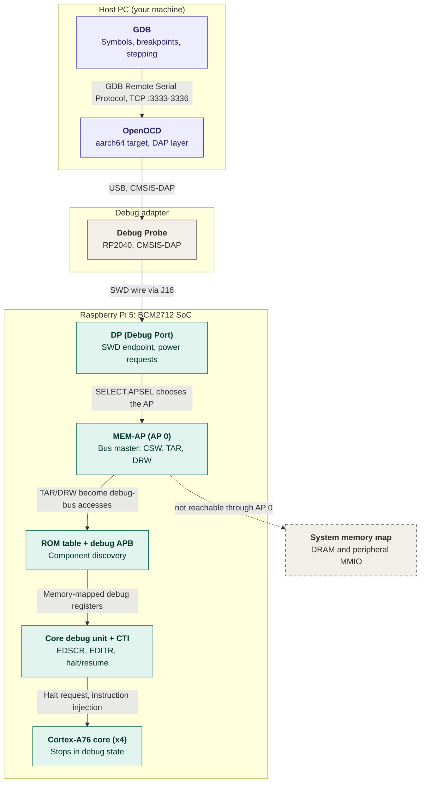
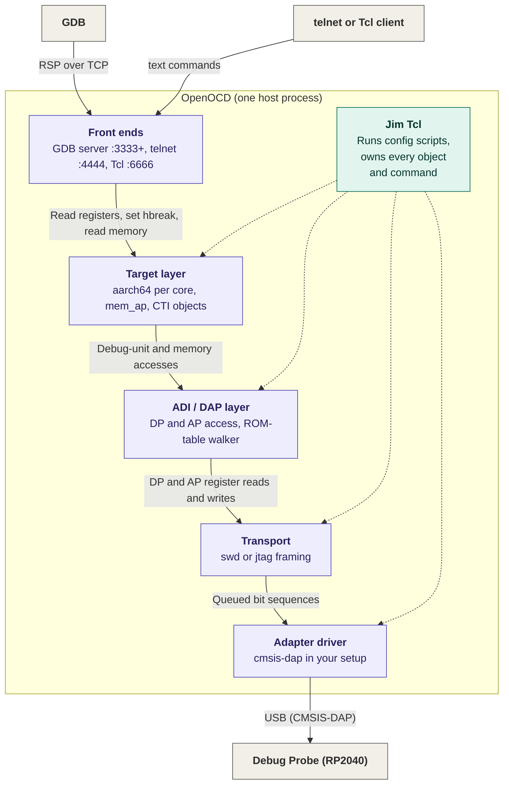
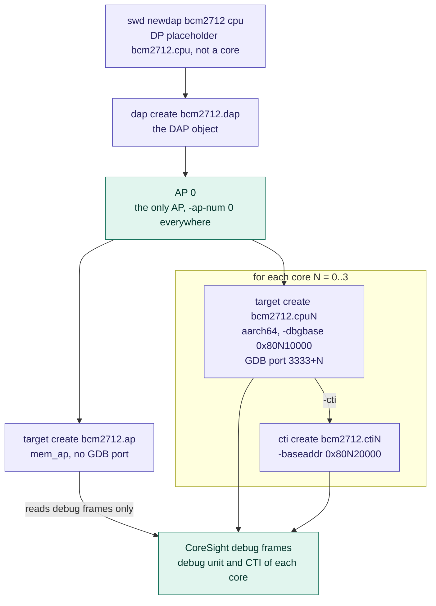
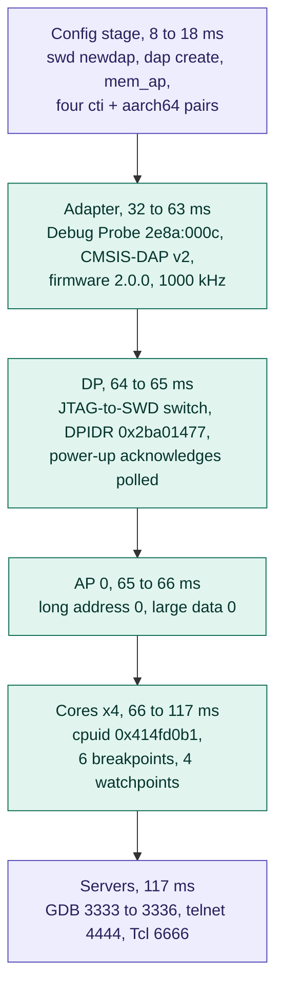
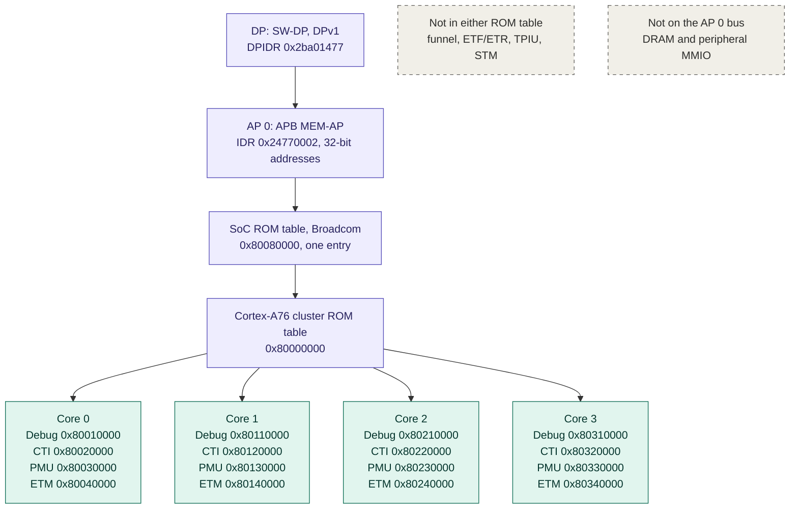
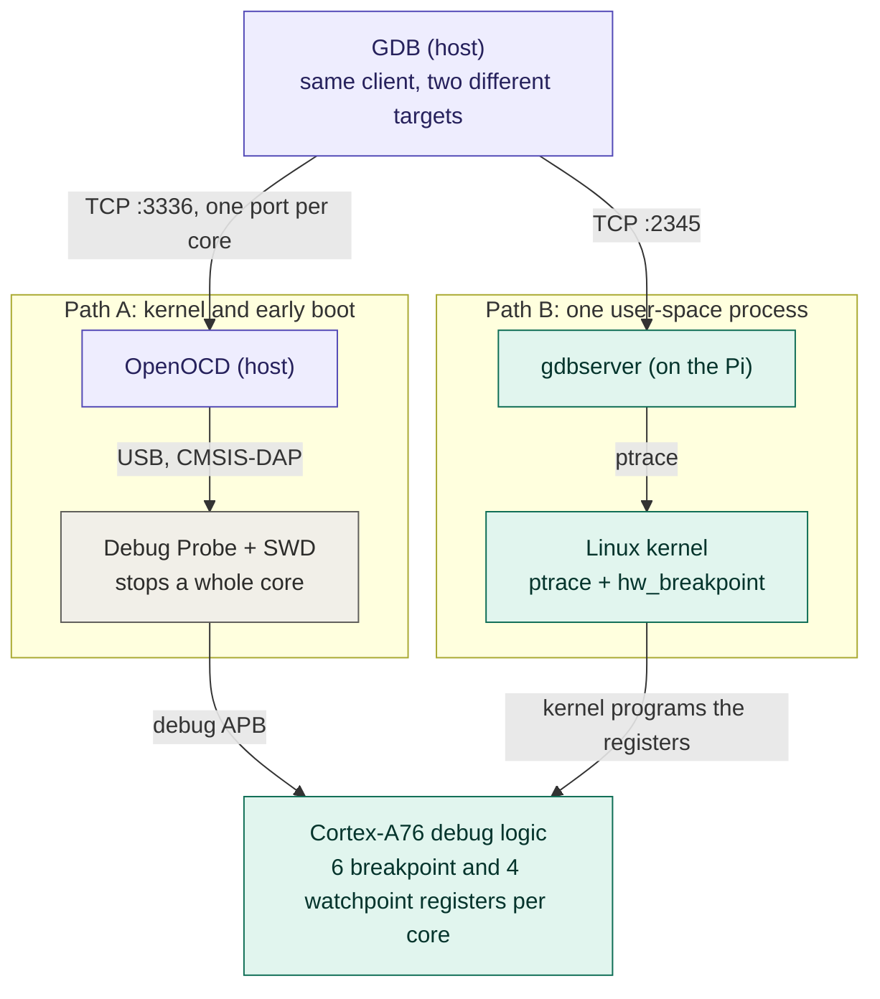
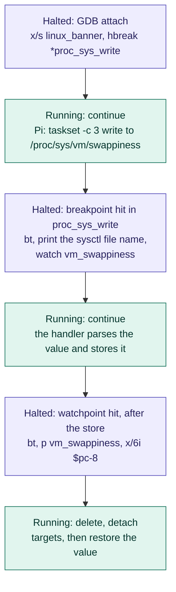

> OpenOCD `bcm2712.cfg` · Arm ADIv5 / CoreSight · `fs/proc/proc_sysctl.c`, `kernel/sysctl.c`, `mm/vmscan.c` · Linux v6.18.60 (Raspberry Pi tree, local build `6.18.60-dbg+`)
> Verified against: [ocd.log](/assets/linux-debug/ocd.log) (OpenOCD `-d3` bring-up), [ocd-dapinfo.txt](/assets/linux-debug/ocd-dapinfo.txt) (`targets`, `dap info 0`, `mdw`), [gdb.log](/assets/linux-debug/gdb.log) (GDB 18.1 on MSYS2)
> Board: Raspberry Pi 5 (BCM2712 D0), Cortex-A76 r4p1, Raspberry Pi Debug Probe over SWD

## 1. Debug path: GDB to the core

The debugger never runs code under the Pi's OS. GDB speaks the Remote Serial Protocol, OpenOCD turns each request into register accesses on the Arm debug port, the probe carries those accesses over SWD, and the debug port (DP) and access port (AP) turn them into reads and writes of the per-core debug registers. A halted core can then be inspected whatever Linux was doing.



Purple: software on the host. Teal: hardware on the Pi. Gray: the external probe. Dashed: not reachable through AP 0 (§3.2).

### Boundaries

| Boundary | Protocol | What crosses it |
|---|---|---|
| GDB to OpenOCD | RSP over TCP, ports 3333 to 3336 | register, memory, breakpoint and run-control packets; `qRcmd` carries `monitor` commands |
| OpenOCD to probe | USB, CMSIS-DAP v2 | batched DP and AP register accesses |
| Probe to SoC | SWD on J16 (SWCLK, SWDIO, GND) | request, ACK and data packets; the connector has no reset line |
| DP to AP | `SELECT.APSEL` | which AP the next access targets |
| AP to debug bus | `TAR`, `DRW` | reads and writes at 32-bit debug-bus addresses |
| ROM table to debug frames | ROM table entries | the base address of each per-core component |
| Debug frame to core | external debug registers | halt request, instruction injection, breakpoint and watchpoint registers |

SEGGER's Pi 5 page documents the J16 pinout and `enable_jtag_gpio=1` in `config.txt` as the switch that enables the port.

### What each route reaches

| Access | Route | Core halted |
|---|---|---|
| Debug-frame registers (`EDSCR`, `EDPRSR`, identity registers) | `bcm2712.ap mdw`, through AP 0 | no |
| Core registers (`x0` to `x30`, `pc`, `cpsr`) | debug frame, instruction injection | yes |
| DRAM, kernel memory, MMIO | through the halted core | yes |

AP 0 sits on a dedicated debug bus ("system memory not present", §3.2), so memory outside the debug frames cannot be read through it. On a running core such a read is refused:

```
> bcm2712.cpu0 mdw 0x0 1
aarch64_mmu: target bcm2712.cpu0 not halted
```

A halted core translates addresses with its own MMU state, so a kernel virtual address works directly.

## 2. OpenOCD

### 2.1 Architecture

OpenOCD is one host process built around a Tcl interpreter. The config is a script that creates objects, and every object becomes a command. This section describes the structure and the behavior seen in `ocd.log`; internal function names were not checked against the OpenOCD source.



Purple: OpenOCD layers. Teal: the Tcl interpreter, which runs the config scripts and owns every object (dotted lines). Gray: programs and hardware outside OpenOCD.

OpenOCD runs in two stages:

| Stage | What happens | Typical failure |
|---|---|---|
| Configuration | the scripts run and declare the adapter, transport, DAP and targets; hardware is untouched | Tcl errors, unknown commands |
| Run (`init`) | open the adapter, connect SWD, read `DPIDR`, power up the debug domain, examine the DAP and each target, start the servers | DAP init failure, "target not examined" |

Ports (all seen in the log): GDB starts at 3333 and each `aarch64` target gets the next port, telnet is 4444, Tcl RPC is 6666. The `mem_ap` target gets no GDB port.

### 2.2 `bcm2712.cfg` walkthrough

The file comes from the tnishinaga gist, which says it is based on OpenOCD's `target/bcm2711.cfg` and was tested with OpenOCD 0.12.0 and the Debug Probe.



Per-core addresses (taken from the ROM table; §3.2 shows the same values):

| Core | Target | Debug unit | CTI | GDB port |
|---|---|---|---|---|
| 0 | `bcm2712.cpu0` | `0x80010000` | `0x80020000` | 3333 |
| 1 | `bcm2712.cpu1` | `0x80110000` | `0x80120000` | 3334 |
| 2 | `bcm2712.cpu2` | `0x80210000` | `0x80220000` | 3335 |
| 3 | `bcm2712.cpu3` | `0x80310000` | `0x80320000` | 3336 |

Settings that matter:

| Setting | Value | Note |
|---|---|---|
| `transport select swd`, `adapter speed 1000` | SWD at 1000 kHz | |
| `CHIPCORES` | default 4 | `-c "set CHIPCORES 1"` before `-f bcm2712.cfg` limits OpenOCD to core 0 (untested) |
| `USE_SMP` | default 0 | cores are independent targets; a breakpoint exists only in the core it was set through |
| `DAP_TAPID` | default `0x2ba00477` | inherited from the BCM2711 config; the board returns `0x2ba01477` and OpenOCD proceeds without a warning |
| `targets bcm2712.cpu0` (last line) | `cpu0` is the default target | the `*` in the `targets` listing |
| `-ap-num 0` | on `mem_ap`, every CTI and every core | AP 0 is the only AP |

### 2.3 Command surface

Commands come in two kinds:

| Form | Commands | Acts on |
|---|---|---|
| `bcm2712.cpuN <cmd>` | `mdw`, `mdb`, `read_memory`, `write_memory`, `curstate`, `aarch64 disassemble`, `aarch64 maskisr`, `catch_exc` | that target |
| global | `halt`, `resume`, `step`, `reg`, `bp`, `reset` | the current target (the `*` in `targets`) |
| selection | `targets bcm2712.cpu3` | makes `cpu3` the current target |

#### `mdw`

`mdw [phys] <address> [count]` reads 32-bit words; `count` is in words. The size family changes only the unit (`mdb` byte, `mdh` halfword, `mdd` doubleword), and `mww address value` is the write form. Which object runs it decides the route:

| Form | Route | Needs halt |
|---|---|---|
| `mdw 0x...` | current target (`cpu0`) | yes |
| `bcm2712.ap mdw 0x...` | AP 0, debug frames only | no |
| `bcm2712.cpuN mdw 0x...` | through core N | yes |

Output is eight words per line, with the address of the first word on the left:

```
> bcm2712.ap mdw 0x80010fd0 12
0x80010fd0: 00000004 00000000 00000000 00000000 0000000b 000000bd 0000005b 00000000
0x80010ff0: 0000000d 00000090 00000005 000000b1
```

Through AP 0 each word costs the standard ADIv5 sequence: write `CSW` (size, auto-increment), write `TAR`, read `DRW` once per word, read `RDBUFF` for the last posted result. This is the mechanism, not a captured trace (see the `-d3` limit below). Reads have real side effects: reading a FIFO or read-to-clear register changes its state, while identity registers are safe. A bus error sets a sticky flag in the DP, after which later accesses fail until it is cleared.

#### Quirks seen in the logs

| Quirk | What happened |
|---|---|
| `bcm2712.cpu3 halt` | printed the target's subcommand help tree; `halt` is global, so `targets bcm2712.cpu3` comes first |
| Tcl loops | results are not echoed: `foreach b {...} { bcm2712.ap mdw $b 1 }` printed `empty`; wrap in `puts [...]` |
| Leaving telnet | `exit`; `quit` is not a command |
| `-d3` | logs commands and driver messages but no `TAR`/`DRW` lines; register-level transfers need a finer level (I believe `-d4`, untested) |
| GDB attach | the default `gdb-attach` event runs `halt 1000`, so attaching halts that core; after `detach` check `targets` and `resume` if the core still shows `halted` |

## 3. Hardware verification on the board

### 3.1 Bring-up timeline (`ocd.log`)

```
openocd -f interface/cmsis-dap.cfg -f bcm2712.cfg -d3 -l ocd.log
```



Decodes:

| Value | Decode |
|---|---|
| `DPIDR 0x2ba01477` | revision 2, part `0xBA`, DP version 1 (DPv1), designer Arm (`0x23B`); a SW-DP |
| ADI version | "configured by default to use ADIv5 protocol" |
| `cpuid 0x414fd0b1` | implementer `0x41` (Arm), variant 4, part `0xd0b` (Cortex-A76), revision 1: r4p1 |
| `debug = 0x10305408` | debug version 8 (Armv8.2), 6 breakpoints, 4 watchpoints |
| `long address 0` | AP 0 has a 32-bit address register |

The config's expected `DPIDR` (`0x2ba00477`) does not match the board's value, and OpenOCD does not complain, so the expected ID is not enforced for SWD. Harmless noise in the same log: failed opens of an unrelated USB device (`0x1022:0x1639`), repeated "command already registered" lines from creating four `aarch64` targets, and "refusing to enable sticky overrun detection" from the CMSIS-DAP driver.

### 3.2 `dap info 0` decode

Run from the telnet session after `targets` showed all five targets `running` (trimmed):

```
> dap info 0
AP # 0x0
                AP ID register 0x24770002
                Type is MEM-AP APB2 or APB3
MEM-AP BASE 0x80080003
                Valid ROM table present
                Component base address 0x80080000
                Peripheral ID 0x01000bfa97
                Designer is 0x0bf, Broadcom
                Part is 0xa97, Unrecognized
                Component class is 0x1, ROM table
                MEMTYPE system memory not present: dedicated debug bus
        ROMTABLE[0x0] = 0xfff80003
                Component base address 0x80000000
                Peripheral ID 0x04007bb4e4
                Part is 0x4e4, Cortex-A76 ROM (ROM Table)
                Dev Arch is 0x47700af7, ARM Ltd "CoreSight ROM architecture" rev.0
        [L01] ROMTABLE[0x0] = 0x00010003
                Component base address 0x80010000
                Peripheral ID 0x04005bbd0b
                Part is 0xd0b, Cortex-A76 Debug (Debug Unit)
                Type is 0x15, Debug Logic, Processor
                Dev Arch is 0x47708a15, ARM Ltd "Processor debug architecture (v8.2-A)" rev.0
        ...
```

AP 0:

| Field | Value | Decode |
|---|---|---|
| `IDR` | `0x24770002` | revision 2, designer Arm, class 8 (MEM-AP), type 2 (APB2 or APB3) |
| `BASE` | `0x80080003` | ROM table at `0x80080000`, present bit set |
| MEMTYPE | "system memory not present: dedicated debug bus" | AP 0 reaches debug components only |
| `dap info 1`, `dap info 2` | `IDR 0x00000000`, "No AP found" | AP 0 is the only AP |

ROM tables:



An entry is a signed offset from the table's own base plus flag bits: `0xfff80003` is offset `-0x80000` from `0x80080000`, landing on `0x80000000`, with the present bit (bit 0) set. Entries ending in `2` or `6` are marked "Component not present". The two levels (an SoC table pointing to a cluster table) confirm a nested layout.

Every per-core block reports part `0xd0b`, so OpenOCD labels them all "Cortex-A76 Debug (Debug Unit)". The role comes from the type code and Dev Arch:

| Offset from core base | Component | Type | Dev Arch |
|---|---|---|---|
| `+0x10000` | Debug unit | `0x15` | Processor debug architecture (v8.2-A) |
| `+0x20000` | CTI | `0x14` | Cross Trigger Interface |
| `+0x30000` | PMU | `0x16` | Performance Monitor |
| `+0x40000` | ETM | `0x13` | ETM architecture, rev 2 |

The `mdw` of core 0's identity registers (§2.3) agrees with the ROM walk:

| Words | Registers | Value |
|---|---|---|
| `0x80010fd0` to `fdc` | `PIDR4` to `PIDR7` | `04 00 00 00` |
| `0x80010fe0` to `fec` | `PIDR0` to `PIDR3` | `0b bd 5b 00` |
| `0x80010ff0` to `ffc` | `CIDR0` to `CIDR3` | `0d 90 05 b1` |

That is Peripheral ID `0x04005bbd0b` (Arm, part `0xd0b`) and component class `0x9`, matching the `dap info` line for `0x80010000`.

No trace sink: four ETMs exist, but neither ROM table lists a funnel, replicator, ETF/ETR, TPIU or STM. The ETM at `0x80040000` reports authentication status `0xcc` (non-invasive debug enabled in both security states), so tracing is permitted but there is nowhere to capture it.

## 4. Practical GDB debugging

### 4.1 Two paths

Both paths use GDB and end at the same per-core debug logic, but they get there differently.



| | Path A: kernel via JTAG/SWD | Path B: user space via `gdbserver` |
|---|---|---|
| Stops | one whole core | one process |
| Needs the OS running | no | yes |
| Reaches | any kernel code, a hung kernel, firmware | one process's view |
| Symbols | `vmlinux` | the program's binary |
| Debug registers | programmed by OpenOCD through AP 0 | programmed by the kernel on `gdbserver`'s behalf |

Use Path A when the answer is in the kernel or below, or the OS is already dead. Use Path B for a program of your own: SWD sees cores, not processes, and halts everything scheduled on the core. Both paths use the same 6 breakpoint and 4 watchpoint registers per core, so avoid using both on one core at once (unverified).

### 4.2 Kernel configuration for the examples

GDB needs symbols and a fixed layout; nothing else in the kernel has to know about JTAG. The minimum set:

| Option | Why |
|---|---|
| `DEBUG_KERNEL=y` | gate for the debug options |
| `DEBUG_INFO_DWARF5=y`, with `DEBUG_INFO_NONE`, `DEBUG_INFO_REDUCED`, `DEBUG_INFO_SPLIT` off | types, locals and source lines |
| `RANDOMIZE_BASE` off (or `nokaslr` on the command line) | fixed addresses, so `vmlinux` always matches |
| `KALLSYMS=y`, `KALLSYMS_ALL=y` | data symbols in `/proc/kallsyms` for cross-checks |
| `FRAME_POINTER=y` | reliable `bt` (arm64 normally selects it already) |
| `LOCALVERSION "-dbg"` | a distinct release and module directory |

`DEBUG_INFO_NONE=y` is the setting to avoid: without DWARF, GDB has function names but no types, so `p *ptr`, member access and `watch` on a member fail. `DEBUG_INFO_REDUCED` strips struct detail and defeats the purpose even with DWARF on. The eBPF and tracing option set is kept out of this document.

```bash
make ARCH=arm64 CROSS_COMPILE=aarch64-linux-gnu- bcm2712_defconfig
scripts/config --enable DEBUG_KERNEL --disable DEBUG_INFO_NONE --enable DEBUG_INFO_DWARF5 \
               --disable DEBUG_INFO_REDUCED --disable DEBUG_INFO_SPLIT \
               --disable RANDOMIZE_BASE --enable KALLSYMS --enable KALLSYMS_ALL \
               --set-str LOCALVERSION "-dbg"
make ARCH=arm64 CROSS_COMPILE=aarch64-linux-gnu- olddefconfig
grep -E 'CONFIG_DEBUG_INFO|RANDOMIZE_BASE' .config
```

`scripts/config` only edits text; `olddefconfig` reconciles it with Kconfig and quietly drops a request whose dependencies are not met, which is why the `grep` afterwards matters. After the build:

| Step | Check |
|---|---|
| `file vmlinux` | reports "with debug_info, not stripped" |
| `Image` copied to the Pi as `kernel_2712.img` | the stock kernel stays as a backup copy |
| `cmdline.txt` keeps `earlycon`, `console=ttyAMA10,115200`, and gets `nokaslr` | `grep -c nokaslr /proc/cmdline` prints `1` on the Pi |
| `x/s linux_banner` in GDB | matches `cat /proc/version` on the Pi |
| `p &vm_swappiness` in GDB | equals the address in `sudo grep -w vm_swappiness /proc/kallsyms` |

`vmlinux` stays on the host and must come from the exact build that is running. Start GDB from the kernel tree root (or use `directory <tree>`), otherwise every source line prints "No such file or directory". Modules go into their own `/lib/modules/<release>` directory so the stock modules are untouched.

### 4.3 Kernel example: who writes `vm_swappiness`

Writing a value to `/proc/sys/vm/swappiness` ends in a store to the global `vm_swappiness`. A breakpoint on the sysctl write handler shows the path in, and a hardware watchpoint on the variable shows the instruction that stores to it. No module and no source change are involved. The session below is from `gdb.log` on the `6.18.60-dbg+` build.



Before starting: all four cores running (`targets` in the OpenOCD session), the original value noted (`cat /proc/sys/vm/swappiness`, 60 here), and the checks from §4.2 passing.

#### Attach and verify

```
(gdb) set architecture aarch64
(gdb) target extended-remote localhost:3336
cpu_do_idle () at arch/arm64/kernel/idle.c:32
(gdb) bt
#0  cpu_do_idle () at arch/arm64/kernel/idle.c:32
#1  arch_cpu_idle () at arch/arm64/kernel/idle.c:44
...
#5  cpu_startup_entry (state=state@entry=CPUHP_AP_ONLINE_IDLE) at kernel/sched/idle.c:449
#6  secondary_start_kernel () at arch/arm64/kernel/smp.c:271
#7  __secondary_switched () at arch/arm64/kernel/head.S:404
(gdb) x/s linux_banner
"Linux version 6.18.60-dbg+ (...) #1 SMP PREEMPT Sat Nov  7 06:38:11 UTC 2026"
(gdb) info symbol $pc
cpu_do_idle + 8 in section .text
(gdb) info variables swappiness
File mm/vmscan.c:  202:  int vm_swappiness;
(gdb) p &vm_swappiness
$1 = (int *) 0xffffc00081fc67c8 <vm_swappiness>
(gdb) info functions proc_sys_write
File fs/proc/proc_sysctl.c:  624:  static ssize_t proc_sys_write(struct kiocb *, struct iov_iter *);
```

Port 3336 is `cpu3`. The attach stack ends in `secondary_start_kernel` and `__secondary_switched`, so `cpu3` is a secondary core started through PSCI; GDB stops unwinding at the assembly entry point, which is expected. Line numbers belong to this tree and shift between versions.

#### Break on the handler

```
(gdb) hbreak *proc_sys_write
Hardware assisted breakpoint 1 at 0xffffc000804b1998: file fs/proc/proc_sysctl.c, line 625.
(gdb) continue
Breakpoint 1, proc_sys_write (iocb=0xffffc0008b7b3d68, iter=0xffffc0008b7b3d40)
(gdb) bt
#0  proc_sys_write (iocb=..., iter=...) at fs/proc/proc_sysctl.c:625
#1  new_sync_write (...) at fs/read_write.c:593
#2  vfs_write (...) at fs/read_write.c:686
#3  ksys_write (...) at fs/read_write.c:738
#5  __arm64_sys_write (...) at fs/read_write.c:746
#7  invoke_syscall (...) at arch/arm64/kernel/syscall.c:49
#8  el0_svc_common (...) at arch/arm64/kernel/syscall.c:132
#9  do_el0_svc (...) at arch/arm64/kernel/syscall.c:151
#10 el0_svc (...) at arch/arm64/kernel/entry-common.c:749
#12 el0t_64_sync () at arch/arm64/kernel/entry.S:596
(gdb) x/s ((struct kiocb *)$x0)->ki_filp->f_path.dentry->d_name.name
0xffff8000423e4f38:     "swappiness"
(gdb) p vm_swappiness
$2 = 60
```

A software `break` would write a `BRK` into read-only kernel text, so `hbreak` is used. The `*` form sets it on the function's first instruction, where the AArch64 calling convention still has the arguments in `x0` to `x3`; GDB printed the real `iocb` and `iter` values for that reason, while most other frames show `<optimized out>`. In this tree the sysctl write path takes a `kiocb` and an `iov_iter`, so `x0` is the `kiocb` and `ki_filp` leads to the file name. The write has to run on the attached core, because breakpoints live in that core's debug unit; that is why the trigger uses `taskset -c 3`.

#### Watch the variable

```
(gdb) watch vm_swappiness
Hardware watchpoint 2: vm_swappiness
(gdb) continue
Hardware watchpoint 2: vm_swappiness
Old value = 60
New value = 10
0xffffc000800c0818 in do_proc_dointvec_minmax_conv (..., valp=0xffffc00081fc67c8 <vm_swappiness>, ...)
    at kernel/sysctl.c:736
(gdb) bt
#0  do_proc_dointvec_minmax_conv (...) at kernel/sysctl.c:736
#1  __do_proc_dointvec (...) at kernel/sysctl.c:447
#2  do_proc_dointvec (...) at kernel/sysctl.c:480
#3  proc_dointvec_minmax (...) at kernel/sysctl.c:761
#4  proc_sys_call_handler (...) at fs/proc/proc_sysctl.c:600
#5  proc_sys_write (...) at fs/proc/proc_sysctl.c:626
#6  new_sync_write (...) at fs/read_write.c:593
...
(gdb) p vm_swappiness
$3 = 10
(gdb) x/6i $pc-8
   0xffffc000800c0810 <do_proc_dointvec_minmax_conv+88>:  mov  w0, #0x0
   0xffffc000800c0814 <do_proc_dointvec_minmax_conv+92>:  str  w1, [x2]
=> 0xffffc000800c0818 <do_proc_dointvec_minmax_conv+96>:  add  sp, sp, #0x10
   0xffffc000800c081c <do_proc_dointvec_minmax_conv+100>: ret
(gdb) delete
(gdb) detach
```

#### What the log shows

| Observation | Meaning |
|---|---|
| `str w1, [x2]` at `+92`, and `valp` equals `&vm_swappiness` | `x2` holds `valp`; this instruction is the store |
| PC at `+96`, one instruction after the store, and `p vm_swappiness` already `10` | a watchpoint stop is reported after the store completes; no `stepi` is needed to see the new value |
| the store sits in `do_proc_dointvec_minmax_conv`, called from `proc_dointvec_minmax` | the integer sysctl handlers do the write; `bt` gives the whole path back to `proc_sys_write` |
| `buf=0x555608ab8760 ""` although `len=3` | a read of a user address through the core returned an empty string instead of `10\n`; user-pointer reads are not reliable here (cause not established) |
| `Backtrace stopped: previous frame identical to this frame` | expected at assembly entry points (`el0t_64_sync`, `__secondary_switched`) |

After `detach`, run `targets` in the OpenOCD session and `resume` the core if it still shows `halted`. Restore the value with `echo 60 | sudo tee /proc/sys/vm/swappiness`. GDB reports a watchpoint only when the value changed, so write a value different from the current one.

### 4.4 User-space reference

A user-space bug needs none of the above. The program has an off-by-one that overwrites the neighboring field:

```c
struct cfg { int buf[4]; int limit; };
int main(void) {
    struct cfg c = { .limit = 100 };
    for (int i = 0; i <= 4; i++)          /* bug: should be i < 4 */
        c.buf[i] = i * 10;
    printf("limit = %d\n", c.limit);      /* expected 100, prints 40 */
    return 0;
}
```

Steps (not run on the board, so unverified):

1. On the Pi: `gcc -g -O0 -o overflow overflow.c`, then `gdbserver :2345 ./overflow`.
2. On the host: `gdb-multiarch ./overflow`, `target remote <pi-ip>:2345`.
3. `break main`, `continue`, then `watch c.limit` and `continue`.
4. GDB stops on the corrupting store with old value `100` and new value `40`; `p &c.buf[4] == &c.limit` prints `1`.

The watchpoint is one of the same 4 per-core registers, programmed by the kernel through `ptrace` instead of by OpenOCD.
